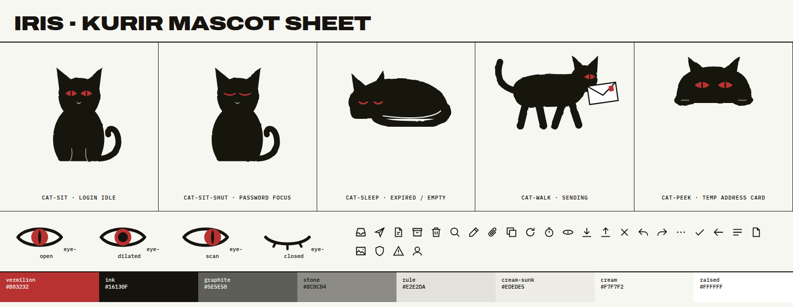

# IRIS mascot and illustration style guide

Assets: `mascot-sprite.svg` (symbols), `mascot-sheet.png` (reference render). Colors come from `iris-tokens.css`.

## Character: "Kurir"
Kurir is a black cat who carries mail and watches the route. It is a courier and a watchman, not a pet.
Its personality is calm, alert, and a little aloof. It never waves, winks, or grins, and it never shows
more emotion than the eyes allow.

Kurir is a separate character from the official Meow Labs logo, which is a white-on-black negative-space
cat. Kurir never replaces or edits the parent logo. **Arya must approve Kurir before ship**: the earlier
`design.md` §12 forbids a mascot in core mail flows without approval. Under this guide, Kurir appears
only in the placements listed below.

## Construction
- **Silhouette first.** The cat is a solid ink (#16130F) shape. Read it at 32px: if the ears and tail don't identify a cat, redraw.
- **Ink edge.** Outlines get a slight brush wobble from the `#ink` filter (feTurbulence + feDisplacement, scale ≈3). No clean vector outlines and no stroke-and-fill line art.
- **Highlights.** Highlights are cream line breaks, 1.5–2px at 55% opacity, cut into the black to separate legs or tail from the body. They work like dry-brush gaps. Never use gray fills.
- **Palette.** Exactly ink, vermilion (#B83232), and cream. No gradients, no blush, no white sparkle eyes.
- **Proportion.** Heads are about 1/3 of body height and ears are sharp triangles. Bodies are heavy and grounded, not chibi.

## The eye (the IRIS metaphor)
The eye is the brand's core idea: IRIS sees mail arrive, follow its route, and land.
- The iris is a vermilion almond with an ink slit pupil. The same glyph is used in:
  - the wordmark mark (`eye-*`)
  - the unread dot (a 10px disc with a slit)
  - the cat's eyes
- Eye states carry all expression:

| State | Symbol | Meaning | Used for |
|---|---|---|---|
| Open, slit pupil | `eye-open` | watching, idle | default |
| Dilated, round pupil | `eye-dilated` | attention, something wrong | error, new mail arrived |
| Shifted pupil | `eye-scan` | looking toward something | following the caret, pointing to the address |
| Closed, lash ticks | `eye-closed` | privacy, rest | password focus, expired |

- Pupil motion is at most a ±6px translate over 320ms (`--iris-dur-slow`). It is disabled under reduced motion.

## The journey of a message
Mail travelling is shown with three postal devices drawn in the same ink:
1. **Route line**: a 1.5px dashed ink line with square hop nodes and a red round node for the destination. In the product it appears as the reader's Route trace, and on login as the line the cat sits on.
2. **Envelope**: a white rectangle with a 2.5px ink border, a V flap, and a small red stamp rectangle. It is carried in the mouth by `cat-walk`.
3. **Postmark**: a double-ring circle with mono caps text such as "IRIS · DELIVERED · 30 OCT". It is reserved for the success confirmation after send (Phase 7).

## Pose library (in `mascot-sprite.svg`)

| Symbol | Pose | Placement | Size |
|---|---|---|---|
| `cat-sit` | sitting, eyes open | Login brand field, on the route line | 200–260px tall |
| `cat-sit-shut` | sitting, eyes closed | Login while the password field is focused | same |
| `cat-peek` | head and paws over an edge | Temp address card, top edge | 120–160px wide |
| `cat-sleep` | curled, tail wrapped | Expired temp inbox; later, the empty inbox | 200–260px wide |
| `cat-walk` | walking, envelope in mouth | Sending/sent (Phase 7) | 240–300px wide |

## Rules
- At most one mascot per screen. None inside dense working views (the list or reader with content).
- The mascot never conveys information alone. Text always states the meaning. SVGs are `aria-hidden="true"`.
- Don't add speech bubbles, costumes, other animals, or seasonal variants.
- Use idle animation only for pupil movement and eye close. The body never bounces or wiggles.
- On a vermilion field, the cat's irises flip to cream with an ink pupil so they stay visible.

## UI icons (same sprite, `i-*`)
- 20×20 grid with a 1.5px stroke, square caps, and miter joins. Icons are geometric, not brush. Brush texture is reserved for illustration so UI stays crisp.
- Icons use `currentColor`. Fills are only for small dots (more, image sun).
- The set has 26 icons: inbox, send, draft, archive, trash, search, pen, clip, copy, refresh, timer, eye, download, upload, close, reply, forward, more, check, back, menu, file, image, shield, alert, account.
- Icon-only buttons need an `aria-label`.
